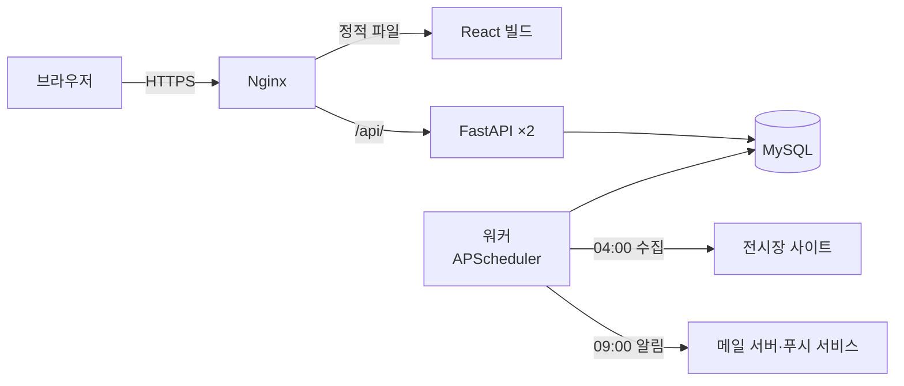
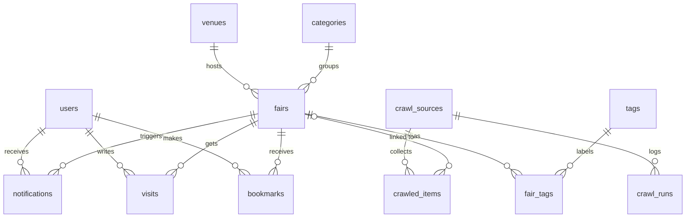

# 페어픽 (FairPick)

**일반인이 즐길 수 있는 식음료·문화·이색 박람회를 한곳에 모으고, 관람 조건과 사전등록 마감까지 알려주는 웹 서비스입니다.**

> 배포 링크·데모 GIF: 서버 배포 후 추가 예정 ([배포 가이드](docs/deploy.md))

## 만든 이유

- 박람회 일정이 코엑스, 킨텍스, aT센터, 벡스코 등 **전시장 사이트마다 흩어져** 있습니다.
- 업계 종사자 대상(B2B) 행사인지, **일반인도 입장할 수 있는지** 한눈에 알기 어렵습니다.
- 사전등록하면 무료나 할인인 행사가 많지만 **마감일을 놓치기 쉽습니다.**
- 데이트·주말 나들이 관점의 정보(체험, 시식, 이색 요소)는 공식 사이트에 정리돼 있지 않습니다.

## 주요 기능

| 구분 | 기능 |
| --- | --- |
| 찾기 | 홈 큐레이션(이번 주말·내 주변·사전등록 마감 임박), 카테고리·태그(모두 포함)·지역·기간·무료·일반인 관람 필터, 한글 전문 검색, 내 주변 박람회(거리순·반경, 위치는 약 1km 단위로만 쓰고 저장 안 함), 월간 캘린더 |
| 상세 | 일반인 관람 여부(전체/일부 날짜/업계 전용), 현장·사전등록 입장료, 사전등록 D-day, 관람 팁, 정보 확인일, 오시는 길(주소·주차 요금·OpenStreetMap 지도·카카오맵 길찾기), 공유, 캘린더(.ics) |
| 회원 | 이메일·카카오·구글 로그인, 북마크(낙관적 업데이트), 관람 노트·공개 후기·좋아요, 태그 투표(3표 이상 반영), 비밀번호 재설정, 알림 설정, 탈퇴 |
| 알림 | 사전등록 마감 D-1, 개막 D-3, 북마크한 박람회 정보 변경을 메일과 브라우저 알림(웹 푸시, 기기별)으로. 중복 발송 없음, 로그인 없이 수신 거부 |
| 수집 | 전시장 6곳(코엑스·킨텍스·SETEC·수원메쎄·엑스코·코엑스 마곡) 일정 매일 04:00 자동 수집 → 검수 큐(정규화 결과·병합 후보) → 관리자 승인 후 공개. robots.txt 가 막은 aT센터·벡스코는 수집하지 않고 직접 등록 |
| 관리 | 박람회 등록·수정·숨김, 검수, 수집 이력·연속 실패 메일, 엑셀 내보내기 |
| 분석 | 월별·카테고리별·전시장별 통계 화면(`/report`), [pandas 분석 노트북](analysis/fairs_report.ipynb). 지난 7년(2019~2025) 전시장 6곳(코엑스·킨텍스·SETEC·엑스코·수원메쎄·코엑스 마곡) 행사 3,132건으로 연도별 추이(처음부터 기록이 있는 4곳 기준 2020년 코로나로 58% 감소 → 2023년 회복)와 주제별 성수기(식음료 11월 등) |

## 기술 스택

| 영역 | 선택 | 이유 |
| --- | --- | --- |
| 프론트엔드 | React 19 + Vite, React Router, TanStack Query, Tailwind CSS, Recharts | 서버 데이터는 Query 캐시로, 필터 상태는 URL 쿼리스트링으로 관리 |
| 백엔드 | FastAPI (동기 `def` + 동기 SQLAlchemy) | `/docs` 자동 API 문서, Pydantic 검증. async 안에서 동기 DB 호출로 이벤트 루프가 막히는 문제를 피함 |
| DB | MySQL 8.4, SQLAlchemy 2.0, Alembic | ENUM·CHECK·ngram FULLTEXT, 스키마 변경 이력 관리 |
| 인증 | PyJWT + pwdlib(Argon2) | FastAPI 공식 튜토리얼 조합 |
| 수집·작업 | httpx + BeautifulSoup, APScheduler(별도 워커), SMTP + Jinja2 | 워커를 API 와 분리해 API 를 여러 개 띄워도 작업이 한 번만 실행 |
| 인프라 | Docker Compose, Nginx, GitHub Actions | 프론트와 API 를 한 도메인에 묶어 쿠키·CORS 문제 제거 |

## 아키텍처



브라우저는 Nginx 만 알고, 외부 사이트와 메일 서버에 닿는 것은 워커뿐입니다.

## ERD (1단계)



컬럼과 인덱스: [docs/erd.md](docs/erd.md), [docs/schema.sql](docs/schema.sql)

## 핵심 설계 3가지

1. **수집 결과를 바로 공개하지 않는다 (검수 큐).** 일반인 관람 여부는 자동 판별이 어렵고 틀린 정보는 신뢰를 잃게 합니다. 크롤러는 이름·기간·장소만 가져오고, `content_hash` 로 새 항목·바뀐 항목만 검수 큐에 올립니다. 다른 소스의 같은 행사는 장소·기간·제목 유사도로 *병합 후보*만 보여주고 자동 병합하지 않습니다.
2. **알림 중복 방지를 DB 가 보장한다.** `UNIQUE(user_id, fair_id, type, ref_key, channel)` + `INSERT IGNORE`. 같은 날 작업이 두 번 돌아도 알림은 1건이고, 사전등록 마감이 연장되면 `ref_key`(마감 일시)가 바뀌어 한 번 더 나갑니다.
3. **진행 상태와 D-day 는 저장하지 않고 계산한다.** 저장하면 매일 갱신해야 하고 값이 어긋납니다. '오늘'은 DB 의 `CURDATE()` 가 아니라 앱에서 한국 시간으로 계산해 넘겨, UTC 서버에서 자정 무렵 하루 어긋나는 문제를 막습니다.

그 밖에: 입장료 `NULL`(모름)과 `0`(무료)을 구분, 박람회는 지우지 않고 숨김, 리프레시 토큰은 httpOnly 쿠키 + 해시 저장 + 회전(폐기된 토큰 재사용 시 전체 폐기), 로그인 횟수 제한(이메일당 15분 5회·IP당 20회, 잠긴 동안은 비밀번호도 검사하지 않음) + Nginx 인증 API 요청 수 제한.

## 트러블슈팅

실제로 겪은 문제와 해결입니다. 자세한 내용: [docs/troubleshooting.md](docs/troubleshooting.md)

| 문제 | 원인 | 해결 |
| --- | --- | --- |
| Windows 에서만 상세 API 가 500 | Windows 에 IANA 시간대 DB 가 없어 `ZoneInfo("Asia/Seoul")` 실패 | `tzdata` 패키지 추가 |
| `alembic` 명령이 `UnicodeDecodeError` | Alembic 이 `alembic.ini` 를 OS 인코딩(cp949)으로 읽음 | 설정 파일은 ASCII 로만 작성 |
| Nginx 보안 헤더가 일부 응답에서 사라짐 | `location` 안에 `add_header` 가 있으면 `server` 단 헤더를 물려받지 않음 | location 의 캐시 설정을 `expires` 로 바꿈 |
| 검색 테스트만 결과 0건 | InnoDB FULLTEXT 인덱스는 커밋된 행만 본다. 테스트는 롤백 트랜잭션 안에서 돌았음 | 전문 검색 테스트는 데이터를 커밋하고 끝나면 지움 |
| 로그인이 이유 없이 풀림 | 리프레시 토큰 회전 + 동시 재발급 요청 2개 → 두 번째가 '폐기 토큰 재사용'으로 탐지 | 재발급 요청을 하나로 묶는 single-flight |
| IP 기준 제한을 헤더 하나로 우회 가능 | Nginx 가 클라이언트의 `X-Forwarded-For` 에 덧붙이고, uvicorn(`--forwarded-allow-ips "*"`)은 맨 앞 값을 IP 로 씀 | Nginx 에서 `$remote_addr` 로 덮어씀 |
| 달력형 사이트에서 같은 행사가 날짜마다 따로 수집될 뻔함 | 달력은 행사가 열리는 날짜 칸마다 같은 행사를 반복해 보여줌 | 행사 ID 로 날짜를 모아 가장 이른 날 ~ 가장 늦은 날을 기간으로. 지난달 달력도 받아 달을 넘기는 행사를 합침 |
| `"12.30 ~ 1.2"` 는 되는데 `"2026.11.22 ~ 2026.11.19"` 도 통과 | 해 넘김 규칙이 끝 연도를 명시한 경우에도 적용됨 | 끝 연도를 생략했을 때만 해 넘김으로 해석 |
| 새로고침하면 북마크가 풀린 것처럼 보임 (E2E 로 발견) | 화면이 로그인 복구보다 먼저 비로그인으로 데이터를 받고 다시 받지 않음 | 로그인 복구가 끝나면 진행 중인 요청 취소 후 쿼리 무효화 |
| 로그인 후 가끔 원래 페이지가 아닌 홈으로 감 (E2E 로 발견) | 로그인 순간 '비로그인 전용' 가드가 홈으로 보내는 것과 `navigate(next)` 가 경쟁 | 가드도 `next` 로 보냄 |

## 테스트 전략

세 층으로 테스트하고, PR 마다 GitHub Actions 가 모두 실행합니다. 자세한 내용: [docs/testing.md](docs/testing.md)

| 층 | 도구 | 개수 |
| --- | --- | --- |
| 백엔드 | pytest, **MySQL 8.4** (SQLite 가 아님) | 216 |
| 프론트 단위·컴포넌트 | Vitest + Testing Library + MSW | 81 |
| E2E | Playwright: 실제 API·DB·빌드한 프론트, 데스크톱·모바일 화면 | 8 시나리오 × 2 |

백엔드는 ENUM·CHECK·INSERT IGNORE·FULLTEXT 문법 차이로 테스트만 통과하는 일을 막으려고 실제와 같은 MySQL 에서 돌립니다.

| 대상 | 무엇을 지키나 |
| --- | --- |
| 날짜·장소 정규화 (순수 함수) | 사이트마다 다른 표기, 해 넘김, 요일 표기, 별칭·홀 분리 |
| 파서 | 저장한 실제 HTML fixture 로만 검증 (실제 사이트에 요청하지 않음). 목록형·연간 표·달력형(달을 넘기는 행사 합치기)·AJAX 응답 |
| 박람회 API | 필터 조합, 기간 겹침, 태그 '모두 포함', 정렬, 비공개 404 |
| 인증·권한 | 소셜 로그인(state 위조·취소·제공자 오류, 확인된 이메일만 기존 회원에 연결 — 제공자 응답은 가짜 HTTP 로), 만료 토큰 401, 리프레시 회전·재사용 탐지, 일반 사용자의 관리자 API 403, 로그인 5회 실패 잠금·창 밖으로 나가면 해제·IP 제한, 재설정 메일 시간당 3통 |
| 북마크·투표·좋아요 | 같은 요청을 두 번 보내도 결과가 같다 (멱등성) |
| 알림 | 같은 날 두 번 실행해도 1건(메일·푸시 각각), 마감 연장 시 재발송, 3회 실패 후 failed, 끝난 푸시 구독(404/410) 정리, 푸시 서비스 외 주소 거부(SSRF) |
| 마이그레이션 | 테스트 DB 를 매번 Alembic 으로 만들어 마이그레이션도 함께 검증 |

시간에 따라 결과가 바뀌는 로직은 `today`·`now` 를 의존성으로 받아 테스트에서 날짜를 고정합니다.

프론트는 **사용자가 겪는 동작**을 확인합니다.

| 대상 | 무엇을 지키나 |
| --- | --- |
| 토큰 재발급 | 만료되면 재발급 후 원래 요청 재시도, 동시에 여러 요청이 만료돼도 재발급은 1번, 재발급 실패 시 로그아웃 |
| 목록 | URL 쿼리 = API 쿼리(주소 공유), 필터를 바꾸면 1페이지로, 위치 없는 거리순 주소는 기본 정렬로 |
| 북마크 | 낙관적 업데이트와 실패 시 되돌리기, 비로그인은 돌아올 주소를 붙여 로그인 화면으로 |
| 로그인·가드 | 외부 주소로 돌려보내지 않음(오픈 리다이렉트), 로그인 후 원래 페이지, 관리자 화면 권한 |
| 위치 | 약 1km 단위로 줄여서만 쓰고, 고정밀 위치를 요청하지 않음 |
| E2E | 가입 → 북마크 → 새로고침해도 유지 → 마이페이지, 리프레시 쿠키가 httpOnly, 검색·필터 주소 공유 |

## 로컬 실행

준비물: Python 3.12+, Node.js 20+, Docker Desktop

```powershell
copy .env.example .env                 # 값 채우기
docker compose up -d db                # MySQL (호스트 포트 3308)

# 백엔드 (터미널 1)
cd backend
py -3.13 -m venv .venv; .venv\Scripts\activate
pip install -r requirements.txt
alembic upgrade head
python -m app.scripts.seed             # 카테고리·태그·전시장·실제 박람회 30건
python -m app.scripts.create_admin --email 내이메일
uvicorn app.main:app --reload --port 8000      # API 문서: http://localhost:8000/docs
pytest                                          # 백엔드 테스트

# 프론트 (터미널 2)
cd frontend
npm install
npm run dev                            # http://localhost:5173
npm test                               # 프론트 단위 테스트
npm run e2e                            # E2E (처음 한 번 npx playwright install chromium, docs/testing.md)

# 수집·알림 워커 (선택)
python -m app.jobs.crawl_job           # 한 번 수집
python -m app.jobs.worker              # 스케줄러
```

메일을 화면으로 확인하려면 `docker compose --profile mail up -d mailpit` 후 `.env` 에 `SMTP_HOST=localhost`, `SMTP_PORT=1025`, `SMTP_STARTTLS=false` (http://localhost:8025).

## 문서

- [배포 가이드](docs/deploy.md) · [트러블슈팅](docs/troubleshooting.md) · [면접 준비 노트](docs/interview.md) · [ERD](docs/erd.md) · [소셜 로그인 설정](docs/social-login.md)

## 회고와 다음 계획

- 지난 행사 주제 분류: 제목 키워드 규칙으로 '기타'를 65%에서 3%로 줄였다(입주박람회·박람회가 아닌 행사는 따로 떼고, B2B 는 '산업·학술'로). 검수 데이터가 쌓이면 학습 기반 분류와 비교해 볼 것
- 기록 시작이 다른 전시장: 수원메쎄 달력은 2020년 7월, 코엑스 마곡은 2024년 11월(개관)부터 기록이 있다. 그대로 더하면 전시장이 늘어난 만큼 박람회가 늘어난 것처럼 보여서, 연도 비교 문구는 2019년부터 있는 4곳 합계로 계산하고 늦게 시작한 곳은 화면에 따로 적었다
- 전시장 지도: 8곳 좌표를 채워 상세 화면에 지도를 넣었다(키 없는 OpenStreetMap). 이 좌표로 '내 주변 박람회'(MySQL ST_Distance_Sphere 거리순·반경 검색)를 만들었다
- 주차 안내: 공식 주차 안내 페이지로 요금을 확인한 5곳(코엑스·코엑스 마곡·SETEC·킨텍스·수원메쎄)만 채웠다. 확인 못 한 곳은 틀린 숫자를 보여 주지 않도록 비워 둔다
