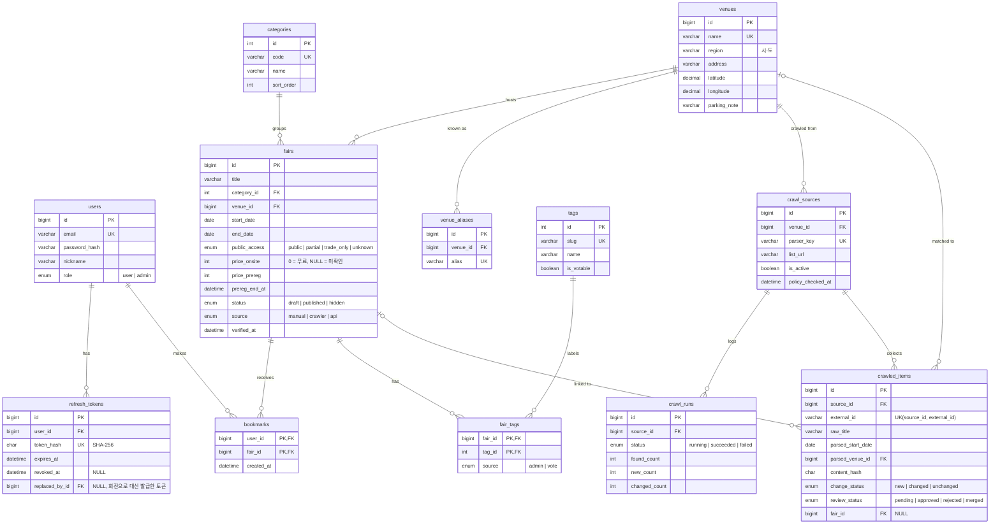

# ERD

1단계(MVP) 테이블 12개의 관계도다. 컬럼 정의와 인덱스는 [schema.sql](schema.sql)에 있다.

## 설계 포인트

- **진행 상태와 D-day는 컬럼이 없다.** 조회할 때 `start_date`, `end_date`와 오늘(KST)로 계산한다. 저장하면 매일 갱신해야 하고 값이 어긋날 수 있다.
- **`price_onsite = NULL`과 `0`은 다르다.** NULL은 아직 모름, 0은 무료다.
- **박람회는 지우지 않는다.** `status = 'hidden'`으로 숨겨 북마크 기록을 보존한다.
- **수집 결과는 바로 공개되지 않는다.** `crawled_items`(검수 큐)에 쌓인 뒤 관리자가 승인해야 `fairs`가 된다.
- **2단계 이후 테이블**(visits, visit_likes, tag_votes, notification_settings, notifications, fair_change_logs, password_reset_tokens, login_attempts, social_accounts)은 해당 주차에 Alembic 마이그레이션으로 추가한다.
